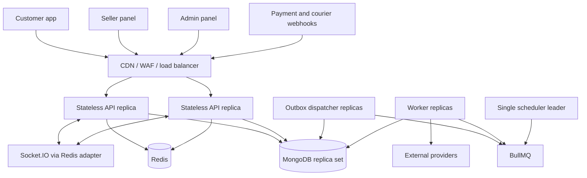
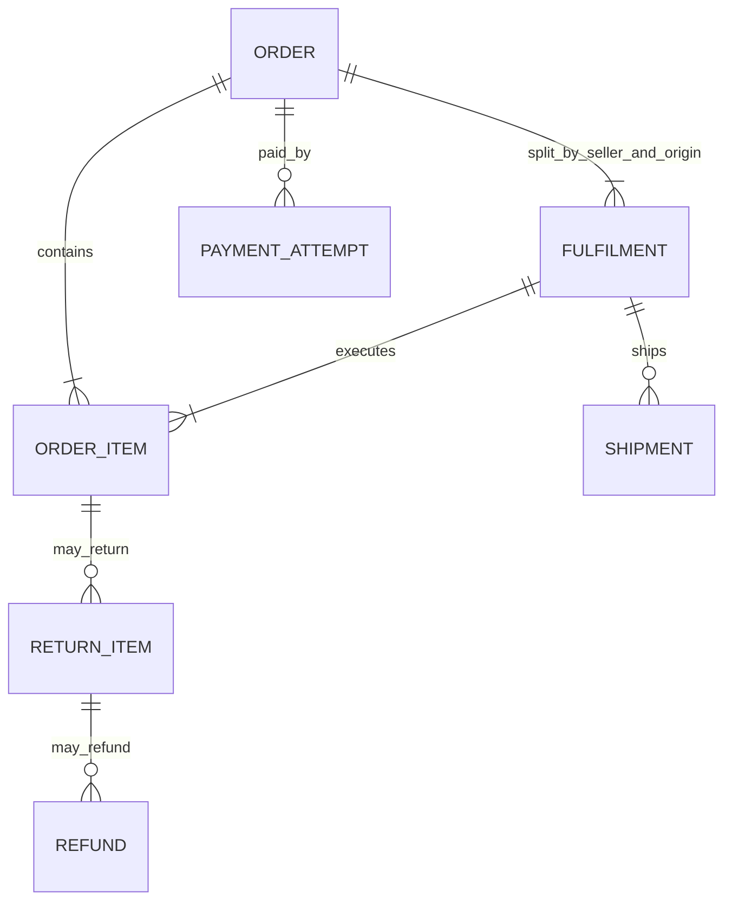
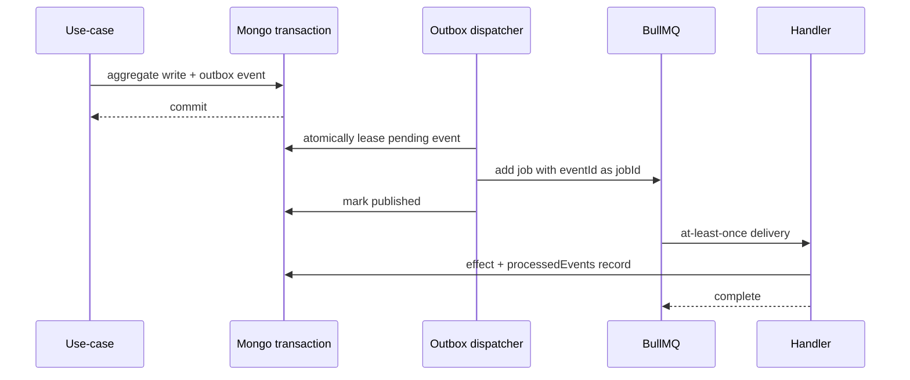

# Arise scalable backend architecture

## 1. Architecture decision

Build one disciplined modular monolith with independently deployable process roles:



The API, worker, outbox, and scheduler are process roles from the same image and repository. This gives independent horizontal scaling without turning local module calls into network calls.

## 2. Runtime surfaces

| Surface | Purpose | Scale rule |
|---|---|---|
| API | HTTP, webhooks, authenticated Socket.IO handshakes | Horizontal; stateless |
| Worker | Event handlers, notifications, provider calls, exports, reconciliations | Horizontal by queue depth; tune concurrency by job type |
| Outbox | Claims Mongo outbox records and publishes BullMQ jobs | Horizontal using atomic leases |
| Scheduler | Registers repeatable jobs and time-based policies | One active leader; jobs remain idempotent |

Production should use a managed load balancer/WAF and managed MongoDB/Redis where possible. Nginx is optional, not a domain requirement.

## 3. Code boundaries

Each bounded context uses as much of this structure as its complexity warrants:

```text
src/modules/<context>/
  domain/           entities, value objects, policies, state machines, events
  application/      commands, queries, DTOs, ports
  infrastructure/   Mongoose repositories, provider adapters, cache adapters
  presentation/
    customer/       /api/customer/v1 adapter
    seller/         /api/seller/v1 adapter
    admin/          /api/admin/v1 adapter
    webhook/        signed provider callbacks
  public/           the only API other modules may import
```

Dependency direction is `presentation -> application -> domain`. Infrastructure implements application ports. A module cannot import another module's models, repositories, domain internals, or presentation layer. Cross-module synchronous needs use the target module's `public/` facade; asynchronous side effects use versioned events.

The supplied `check:boundaries` script is the first automated guard. It should later be supplemented with ESLint import rules and architecture tests.

## 4. Bounded contexts tailored to the clients

| Context | Owns | Important invariants |
|---|---|---|
| Identity & Access | users, credentials, OTP, sessions, admin RBAC, seller staff | rotating refresh sessions, MFA, lockout, role plus ownership checks |
| Customer | profile, addresses, preferences, privacy requests, devices | verified contacts remain authoritative; atomic default address |
| Seller | onboarding, KYC, store, staff, pickup locations, seller status | seller isolation; approval and lifecycle state machine |
| Catalog | categories, brands, products, variants, listings, attributes, buy box | catalog product is distinct from seller offer/listing |
| Inventory & Warehouse | stock balances, reservations, movements, inbound/removal, warehouses | no negative available stock; append-only movement ledger |
| Cart & Wishlist | carts, saved items, wishlist | server reprices; availability is advisory until reservation |
| Pricing & Promotion | price evaluation, coupons, offers, flash sales, fee/tax/shipping quote policies | deterministic quote with versioned rule inputs |
| Checkout | expiring checkout sessions and quote snapshots | quote immutable between revalidation; one order result per idempotency key |
| Order & Fulfilment | orders, items, seller fulfilments, state transitions, invoices | legal transitions; immutable commercial snapshots; seller-scoped actions |
| Payment | payment intents/attempts, provider webhooks, reconciliation | provider webhook is authoritative; unique provider IDs |
| Wallet & Finance | store-credit ledger, gift cards, settlement, payout, commission, tax | double-entry or balanced immutable ledger; no balance-only writes |
| Return & Refund | eligibility, return, replacement, QC, refund orchestration | policy snapshot at purchase; refund never exceeds captured amount |
| Shipping | shipment, manifest, label, pickup, NDR/RTO, tracking webhooks | provider abstraction; monotonic/provider-aware event reconciliation |
| Review & Q&A | reviews, eligibility, moderation, questions/answers | verified purchase; one review per eligible order item |
| Support | tickets, messages, queues, SLA, macros, chat | explicit ticket transitions; immutable conversation/audit history |
| Notification | templates, preferences, inbox, delivery attempts | preference and legal-channel enforcement; deduplicated sends |
| Content & Discovery | home CMS, app config, help, search, media metadata | published versions; signed media workflow; safe cache invalidation |
| Growth | referral, campaigns, ads, segments | budget and wallet controls; approval for sensitive changes |
| Governance | approvals, audit, admin settings, integrations | maker cannot approve own action; secrets are write-only |
| Analytics & Jobs | projections, dashboards, exports, scheduled reports | eventually consistent; never on checkout's critical path |

This is a logical ownership map. Closely related contexts may initially share a top-level module when their team and lifecycle are the same, but collections and public APIs still have one owner.

## 5. API strategy

### Audience adapters

The same use-case may have multiple adapters:

```text
POST /api/customer/v1/orders
  -> CreateCustomerOrder command

POST /api/seller/v1/orders/:id/pack
  -> PackFulfilment command

POST /api/admin/v1/orders/:id/hold
  -> HoldOrder command with privileged policy and audit
```

Controllers only translate HTTP to application input and application output to the contract. Authorization policies live at the application boundary, not only in route middleware.

### Contract rules

- Customer OpenAPI is copied or referenced into backend contract tests; changes are consumer-reviewed.
- Create equivalent admin and seller OpenAPI documents before replacing each mock group.
- Additive fields are allowed in v1; removals, semantic changes, and enum narrowing require a new version or migration window.
- Cursor pagination for customer feeds and high-churn operational lists. Offset pagination is acceptable only for bounded admin tables where stable snapshot semantics are not required.
- Every write returns the resulting resource or accepted job ID, not a vague success string.
- `Idempotency-Key` records include actor, route/operation, normalized request hash, status, response body, and expiry. Reusing a key with a different request hash returns `409`.

## 6. Commerce aggregate and state design

### Order decomposition



`Order` stores the customer, address, seller, product, variant, selected-option, pricing, tax, fee, and policy snapshots used at purchase time. Current catalog documents are never used to reconstruct history.

Customer order status is a projection from payment plus fulfilment/item states. Payment, fulfilment, shipment, return, and refund each keep their own state machine. This prevents impossible combinations from being hidden in a single status field.

### Checkout transaction

1. Authenticate the customer and validate the idempotency record.
2. Load the checkout session and reject expiry/version mismatch.
3. Re-read authoritative listings, price rules, serviceability, and durable inventory.
4. Recalculate integer-paise totals and compare with the quoted version.
5. In one MongoDB transaction:
   - create the order and seller fulfilments;
   - create inventory reservations/movements using conditional stock updates;
   - create/update the payment attempt or COD decision;
   - consume coupon usage if applicable;
   - persist the idempotency result placeholder;
   - append versioned outbox events.
6. Commit, store the response against the idempotency record, and return.
7. Outbox/worker processes trigger notifications, projections, provider work, and realtime hints.

Never hold a database transaction open while calling a payment, shipping, notification, maps, or storage provider.

## 7. Persistence and indexes

MongoDB is the source of truth. Redis is disposable acceleration and coordination.

### Core collection patterns

- `inventoryBalances`: unique `{ sellerId, warehouseId, variantId }`; conditional updates on `available >= requested`.
- `inventoryReservations`: unique reservation ID; index `{ expiresAt: 1 }`; expiry is finalized by an idempotent job, not trusted to TTL deletion alone.
- `orders`: `{ customerId, createdAt }`, `{ orderNumber }` unique, status/read projection fields.
- `orderFulfilments`: `{ sellerId, status, createdAt }`, `{ orderId }`, `{ warehouseId, status }`.
- `payments`: unique sparse provider order/payment IDs; `{ orderId, createdAt }`.
- `shipments`: unique sparse `{ provider, providerShipmentId }` and `{ provider, awb }`; `{ fulfilmentId }`.
- `ledgerEntries`: unique business reference and idempotency key; `{ accountId, createdAt }`.
- `outboxEvents`: `{ status, availableAt, lockedAt, createdAt }`.
- `webhookReceipts`: unique `{ provider, providerEventId }`.
- `processedEvents`: unique `{ eventId, handlerName }`.
- Seller-owned operational collections begin compound indexes with `sellerId` when that matches the authorization/query shape.

Indexes are added from real query/sort plans and verified with `explain`, not copied blindly from field lists. CI should reject unbounded list routes, and production should capture slow queries.

## 8. Reliable event and job model



Delivery is at least once. Exactly-once claims are forbidden in design and documentation. Handlers must be idempotent. Poison jobs go to a visible failed state with alerting and an operator replay path.

Events are past-tense facts (`order.placed.v1`, `payment.succeeded.v1`). Queue jobs are imperative work (`notification.send`, `shipment.create`, `report.generate`). Do not use events when a caller needs an immediate, consistent answer; call a module public facade instead.

## 9. External providers and webhooks

Ports should expose business capabilities, not SDK-shaped methods:

- `PaymentGateway`: create/inspect/refund payment, verify and parse webhook.
- `ShippingProvider`: serviceability, quote, create/cancel shipment, label, pickup, tracking, webhook parsing.
- `NotificationChannel`: render/send/query delivery.
- `ObjectStorage`: presign upload/download, inspect metadata, quarantine/delete.
- `IdentityVerification`: GST/PAN/bank/KYC checks.

Webhook sequence: preserve raw body, identify provider, verify signature before parsing trusted fields, persist a deduplication receipt, acknowledge quickly, then process through a queue. Unknown or out-of-order provider events are stored and reconciled; they never silently regress internal state.

## 10. Security model

- Short-lived access tokens and rotating refresh sessions stored hashed with device/session metadata.
- Customer refresh tokens use platform secure storage; browser panels should prefer secure, `HttpOnly`, `SameSite` cookies in live mode.
- Admin MFA, privileged-session step-up, optional IP allowlists, and shorter idle timeouts.
- Policy checks combine permission, resource ownership/seller scope, actor status, and workflow state.
- All seller queries receive `sellerId` from the authenticated principal; repository APIs require it explicitly.
- Maker-checker for configured high-risk finance, credential, security, and bulk operations. The maker cannot approve their own request.
- Append-only audit facts for admin/seller sensitive actions with actor, subject, before/after redaction, request ID, IP/device, and reason.
- Strict CORS allowlist, Helmet, route-specific Redis rate limits, body/upload limits, malware/media validation, webhook signature verification, and secret-manager injection.
- Logs and errors redact tokens, cookies, OTPs, credentials, bank/card data, and sensitive PII.

## 11. Cache and realtime

Use cache-aside for public catalog, category trees, published CMS/app config, pincode/serviceability data, and selected discovery feeds. Keys carry a schema/version prefix and tenant/seller scope. Events invalidate or advance versioned keys.

Do not treat Redis as authoritative for orders, inventory balances, payments, refunds, wallet balances, approvals, or audit.

Socket.IO emits small invalidation/status messages after durable commit. Room membership is authorized server-side. The Redis adapter is mandatory with multiple API replicas. Clients must recover by refetching after reconnect.

## 12. Observability and operations

Every request/job/event carries `requestId`, and where available `traceId`, `actorId`, `sellerId`, `orderId`, `paymentId`, `shipmentId`, and `eventId` as structured fields.

Minimum service-level indicators:

- API rate, p50/p95/p99 latency, 4xx/5xx rate by operation.
- Checkout success and latency; inventory conflict rate.
- Payment webhook verification failures, processing lag, and reconciliation mismatches.
- Shipment creation failures, webhook lag, stale tracking count, NDR/RTO rates.
- Mongo pool saturation/query latency; Redis latency/errors.
- Queue depth, oldest-job age, retries, failures; outbox oldest-pending age and failed count.
- Socket connection count and publish failures.

Use OpenTelemetry-compatible traces, Pino logs, Prometheus-compatible metrics, error tracking, and alerting tied to SLOs. Health checks are not a substitute for metrics.

## 13. Scaling and extraction criteria

Initial production shape:

- 2+ API replicas across failure zones.
- 2+ outbox/worker replicas; separate high-risk or slow queues when contention appears.
- 1 scheduler leader.
- Managed Mongo replica set with backups/PITR and tested restores.
- Redis with persistence/high availability appropriate to BullMQ's durability needs.

Capacity planning uses concurrent users, RPS by operation, checkout peak, order lines/second, webhook bursts, queue service time, DB working set, and socket concurrency—not registered user count.

A context becomes a service only when measured evidence shows one or more of:

- materially different scaling profile that process-level separation cannot solve;
- independent release/availability requirement;
- data/regulatory isolation requirement;
- stable ownership by an independent team;
- repeated contention that cannot be removed with a module boundary and dedicated worker queue.

Extraction requires a stable public module API/events, no cross-module model reads, an owned datastore migration plan, observability, and failure-mode tests. Until then, the modular monolith is the more scalable organizational choice.

